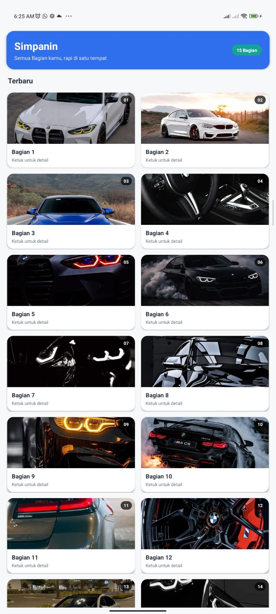
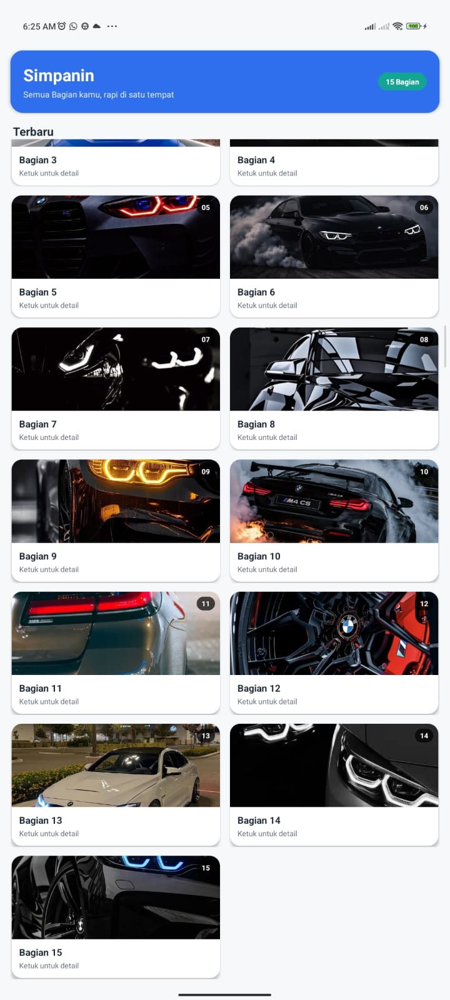

# Simpanin - Modul 2: Layout dan GridView

Aplikasi Android sederhana yang menampilkan galeri 15 gambar dalam bentuk **GridView** dengan tampilan kartu modern. Proyek ini dibuat untuk mempelajari tiga jenis layout Android (**LinearLayout**, **RelativeLayout**, **GridView**) dan penggunaan **Adapter**.

---

## Preview

<p align="center">
  
  &nbsp;&nbsp;&nbsp;
  
</p>

---

## Fitur

- Header berisi nama aplikasi dan badge jumlah Bagian (otomatis dihitung dari adapter).
- Galeri 15 gambar (`pic_1` sampai `pic_15`) dalam grid 2 kolom.
- Setiap item berupa kartu dengan sudut membulat dan bayangan, lengkap dengan badge nomor, judul, dan keterangan.
- Animasi muncul bertahap saat item pertama kali tampil.
- Efek "tekan" dan pesan `Toast` saat item diketuk.
- Mendukung tampilan *edge-to-edge* (tidak tertutup status bar dan navigation bar).

---

## Teknologi

| Komponen | Pilihan |
|---|---|
| IDE | Android Studio |
| Template | Empty Views Activity |
| Bahasa | Java |
| UI | XML Views + Material Components (`MaterialCardView`) |
| Package | `com.example.simpanin_modul_2` |

---

## Struktur File

```
app/src/main/
├── java/com/example/simpanin_modul_2/
│   ├── MainActivity.java
│   └── ImageAdapter.java
└── res/
    ├── drawable/
    │   └── pic_1 ... pic_15        (gambar, disiapkan sendiri)
    └── layout/
        ├── activity_main.xml       (LinearLayout)
        ├── gridview.xml            (GridView)
        └── relative_layout.xml     (RelativeLayout)
```

---

## Penjelasan Tiap File

### `activity_main.xml` (LinearLayout)
Layout utama layar. Root-nya `LinearLayout` vertikal dengan `id="main"`. Isinya:
1. Kartu header biru berisi judul "Simpanin", subjudul, dan badge jumlah Bagian (`tv_count`).
2. Teks "Terbaru".
3. `<include layout="@layout/gridview" />` yang memasukkan GridView ke dalam layar ini.

### `gridview.xml` (GridView)
Berisi satu `GridView` dengan `id="gridview"`:
- `numColumns="2"` untuk dua kolom.
- `layout_height="0dp"` dan `layout_weight="1"` supaya mengisi sisa layar di bawah header.
- `clipToPadding="false"` dan `padding="16dp"` agar kartu paling pinggir dan paling bawah tidak terpotong.

### `relative_layout.xml` (RelativeLayout)
Tampilan **satu item** grid. Di dalam `MaterialCardView`, elemen ditata dengan properti RelativeLayout:
- `img_item`: gambar (tinggi 130dp, `centerCrop`).
- `txt_number`: badge nomor di pojok kanan atas (`layout_alignParentTop` dan `layout_alignParentEnd`).
- `txt_item`: judul "Bagian N" di bawah gambar (`layout_below`).
- Teks keterangan "Ketuk untuk detail" di bawah judul.

### `ImageAdapter.java`
Subclass `BaseAdapter` yang menjadi penghubung antara data (15 gambar) dan GridView.
- Menyimpan array `int[] images` berisi `R.drawable.pic_1` sampai `R.drawable.pic_15`.
- `getCount()` mengembalikan jumlah gambar (15).
- `getView()`:
  - men-*inflate* `relative_layout.xml` bila view belum ada (`convertView == null`),
  - mengisi gambar, judul, dan nomor sesuai `position`,
  - menjalankan animasi muncul hanya saat view pertama kali dibuat.

### `MainActivity.java`
Titik masuk aplikasi. Pada `onCreate()`:
1. Mengaktifkan *edge-to-edge* dan mengatur padding sesuai system bars.
2. Memuat `activity_main.xml` dengan `setContentView`.
3. Mengambil `GridView` (`R.id.gridview`) dan memasang `ImageAdapter`.
4. Mengisi badge jumlah Bagian di header.
5. Memasang `OnItemClickListener` untuk efek tekan dan `Toast`.

---

## Alur Kerja

Hanya `activity_main.xml` yang dipanggil langsung dari kode Java. Dua layout lainnya dipanggil secara tidak langsung.

```
MainActivity
   │  setContentView(R.layout.activity_main)
   ▼
activity_main.xml (LinearLayout)
   ├── Header "Simpanin" + badge jumlah
   └── <include> gridview.xml (GridView)
          │  gridView.setAdapter(new ImageAdapter(this))
          ▼
       ImageAdapter.getView()  ×15
          │  inflate(R.layout.relative_layout)
          ▼
       relative_layout.xml (kartu: gambar + nomor + judul)
```

---

## Peta Pemanggilan File

Bagian ini menjelaskan setiap file dipanggil dari file mana, di bagian kode yang mana, dan untuk apa.

### 1. Pemanggilan layout

| File yang dipanggil | Dipanggil di file | Bagian kode | Fungsi |
|---|---|---|---|
| `activity_main.xml` | `MainActivity.java` | `onCreate()` → `setContentView(R.layout.activity_main);` | Menampilkan layar utama |
| `gridview.xml` | `activity_main.xml` | Baris paling bawah → `<include layout="@layout/gridview" />` | Memasukkan GridView ke layar utama di bawah header |
| `relative_layout.xml` | `ImageAdapter.java` | `getView()` → `inflate(R.layout.relative_layout, parent, false)` | Membuat tampilan satu kartu item, dipanggil 15 kali (sekali per gambar) |

### 2. Pemanggilan kelas Java

| Kelas yang dipanggil | Dipanggil di file | Bagian kode | Fungsi |
|---|---|---|---|
| `MainActivity` | `AndroidManifest.xml` | `<activity android:name=".MainActivity">` (otomatis dari template) | Titik masuk aplikasi |
| `ImageAdapter` | `MainActivity.java` | `onCreate()` → `new ImageAdapter(this)` | Membuat adapter sebagai sumber data GridView |

### 3. Pemanggilan ID (`R.id`)

| ID | Didefinisikan di | Dipanggil di | Bagian kode | Fungsi |
|---|---|---|---|---|
| `main` | `activity_main.xml` (root LinearLayout) | `MainActivity.java` | `onCreate()` → `findViewById(R.id.main)` | Mengatur padding sesuai status bar dan navigation bar |
| `tv_count` | `activity_main.xml` (badge di header) | `MainActivity.java` | `onCreate()` → `findViewById(R.id.tv_count)` | Menampilkan teks "15 Bagian" |
| `gridview` | `gridview.xml` | `MainActivity.java` | `onCreate()` → `findViewById(R.id.gridview)` | Memasang adapter dan klik item |
| `img_item` | `relative_layout.xml` | `ImageAdapter.java` | `getView()` → `findViewById(R.id.img_item)` | Mengisi gambar tiap kartu |
| `txt_item` | `relative_layout.xml` | `ImageAdapter.java` | `getView()` → `findViewById(R.id.txt_item)` | Mengisi judul "Bagian N" |
| `txt_number` | `relative_layout.xml` | `ImageAdapter.java` | `getView()` → `findViewById(R.id.txt_number)` | Mengisi badge nomor (01, 02, dst.) |

### 4. Pemanggilan gambar (`R.drawable`)

| Resource | Dipanggil di file | Bagian kode | Fungsi |
|---|---|---|---|
| `pic_1` sampai `pic_15` | `ImageAdapter.java` | Array `int[] images` di bagian atas kelas | Daftar gambar yang ditampilkan di grid |
| Gambar sesuai urutan | `ImageAdapter.java` | `getView()` → `imageView.setImageResource(images[position])` | Menempelkan gambar ke `img_item` pada tiap kartu |

### 5. Pemanggilan method adapter oleh GridView

Method ini tidak dipanggil manual oleh kita. Android memanggilnya otomatis setelah `gridView.setAdapter(adapter)`.

| Method di `ImageAdapter.java` | Dipanggil oleh | Kapan | Fungsi |
|---|---|---|---|
| `getCount()` | GridView (otomatis) | Saat grid dibuat | Menentukan jumlah kartu (15) |
| `getView(position, ...)` | GridView (otomatis) | Setiap kartu akan ditampilkan atau digulir ke layar | Membuat dan mengisi kartu |
| `getItem()` dan `getItemId()` | GridView (otomatis) | Saat grid membutuhkan data atau ID item | Mengembalikan gambar dan posisi |
| `getCount()` | `MainActivity.java` | `onCreate()` → `adapter.getCount()` | Mengisi teks badge jumlah Bagian |

### 6. Ringkasan: file mana memanggil file mana

```
AndroidManifest.xml
   └─▶ MainActivity.java
          ├─▶ activity_main.xml        (setContentView)
          │      └─▶ gridview.xml      (<include>)
          └─▶ ImageAdapter.java        (new ImageAdapter)
                 ├─▶ relative_layout.xml   (inflate di getView)
                 └─▶ drawable/pic_1 ... pic_15  (array images)
```

Ringkasnya, `MainActivity.java` hanya memanggil `activity_main.xml` dan `ImageAdapter.java`. `gridview.xml` ikut tampil lewat `<include>`, sedangkan `relative_layout.xml` dan gambar `pic_1` sampai `pic_15` dipanggil oleh `ImageAdapter.java`.

---


## Palet Warna

Mengikuti brief proyek Simpanin.

| Peran | Warna |
|---|---|
| Primary (header) | `#2F6FED` |
| Secondary (badge jumlah) | `#12A594` |
| Background | `#F7F8FA` |
| Surface (kartu) | `#FFFFFF` |
| Teks utama | `#1F2937` |
| Teks sekunder | `#6B7280` |

Jarak mengikuti kelipatan 4dp (padding layar 16dp) dan sudut kartu membulat.

---


## Catatan

- Warna ditulis tetap (tema terang), sehingga tampilan tidak berubah saat dark mode aktif.

---
