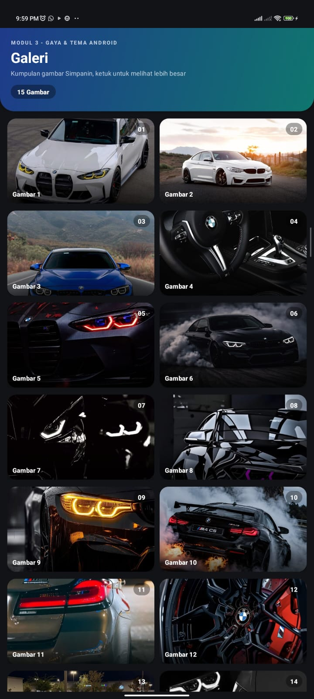
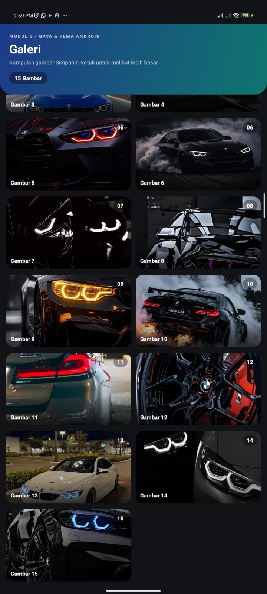
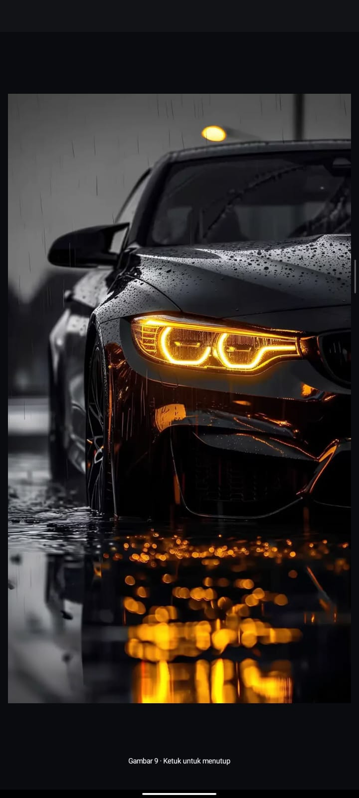

# Simpanin: Modul 3 (Gaya & Tema Android)

Aplikasi Android sederhana (Java, XML View) yang menampilkan galeri 15 gambar memakai **GridView**.
Modul ini berfokus pada penerapan **layout** (Linear, Relative, GridView), **gaya (style)**, dan **tema (theme)** Android dengan Material 3, termasuk dukungan light dan dark mode.

- **Package**: `com.example.simpanin_modul_3`
- **Bahasa**: Java
- **Template**: Empty Views Activity
- **Tema**: Material 3 (`Theme.Material3.DayNight.NoActionBar`)

---

## Tampilan Aplikasi

### Halaman Utama

|                 Tampilan 1                  | Tampilan 2 |
|:-------------------------------------------:|:---:|
|  |  |
|      Header gradien dan galeri 2 kolom      | Daftar gambar saat di-scroll |

### Preview Gambar (Saat Diklik)

<p align="center">
  
</p>

Saat kartu gambar diketuk, gambar tampil layar penuh dengan animasi. Ketuk layar sekali lagi untuk menutup.

---

## Fitur

- Header gradien biru-tosca dengan sudut bawah membulat (tembus ke status bar).
- Galeri 2 kolom dengan kartu gambar membulat, overlay gradasi, label, dan badge nomor.
- Animasi masuk bertahap (fade + naik) dan efek mengecil saat kartu ditekan.
- Ketuk gambar untuk membuka preview layar penuh, ketuk lagi untuk menutup.
- Mendukung dark mode otomatis (mengikuti sistem).

---

## Struktur File

```
app/src/main/
├── AndroidManifest.xml                         (memanggil tema)
├── java/com/example/simpanin_modul_3/
│   ├── MainActivity.java                       (menjalankan GridView)
│   └── ImageAdapter.java                       (mengisi GridView dengan gambar)
└── res/
    ├── layout/
    │   ├── activity_main.xml                   (LinearLayout, layar utama)
    │   ├── gridview.xml                        (GridView)
    │   └── relative_layout.xml                 (RelativeLayout, layout tiap item)
    ├── drawable/
    │   ├── pic_1 ... pic_15                    (15 gambar galeri)
    │   ├── bg_header.xml                       (gradien header)
    │   ├── bg_scrim.xml                        (gradasi gelap di bawah gambar)
    │   └── bg_badge.xml                        (latar badge membulat)
    ├── values/
    │   ├── colors.xml                          (warna mode terang)
    │   ├── themes.xml                          (tema aplikasi)
    │   ├── styles.xml                          (gaya teks dan kartu)
    │   └── strings.xml                         (semua teks)
    └── values-night/
        └── colors.xml                          (warna mode gelap)

screanshoot/
├── tampilan-01.jpeg
├── tampilan-02.jpeg
└── tampilan-click.jpeg
```

---

## Alur Aplikasi

```
AndroidManifest.xml
   └─ memakai tema @style/Theme.Simpanin_modul_3 (themes.xml)
        └─ MainActivity.java dijalankan
             ├─ setContentView(R.layout.activity_main)        -> activity_main.xml (LinearLayout)
             │     └─ <include layout="@layout/gridview"/>    -> gridview.xml (GridView)
             ├─ findViewById(R.id.gridView)
             └─ gridView.setAdapter(new ImageAdapter(this))   -> ImageAdapter.java
                    └─ getView() inflate R.layout.relative_layout -> relative_layout.xml (tiap item)
                          └─ setImageResource(R.drawable.pic_X)   -> pic_1 ... pic_15
```

---

## Keterangan Setiap File dan Di Mana Dipanggil

### 1. Layout

| File | Jenis | Dipanggil di | Cara dipanggil |
|---|---|---|---|
| `activity_main.xml` | LinearLayout | `MainActivity.java` (`onCreate`) | `setContentView(R.layout.activity_main);` |
| `gridview.xml` | GridView | `activity_main.xml` (bagian bawah layout) | `<include layout="@layout/gridview" />` |
| `relative_layout.xml` | RelativeLayout | `ImageAdapter.java` (`getView`) | `LayoutInflater.from(context).inflate(R.layout.relative_layout, parent, false);` |

**`activity_main.xml`** memuat:
- Header (`headerContainer`) berisi teks overline, judul, subjudul, dan badge jumlah gambar.
- `<include>` ke `gridview.xml` dengan `layout_weight="1"` agar mengisi sisa layar.

**`gridview.xml`** memuat `GridView` dengan id `gridView` (2 kolom, jarak 12dp horizontal dan 16dp vertikal).

**`relative_layout.xml`** adalah tampilan satu kartu gambar:
- `MaterialCardView` (`cardImage`) sebagai pembungkus.
- `ImageView` (`imageItem`) untuk gambar.
- `View` overlay gradasi (`bg_scrim`) di bagian bawah.
- `TextView` `tvLabel` (nama gambar) dan `tvBadge` (nomor gambar).

### 2. Kode Java

| File | Tugas | Dipanggil di |
|---|---|---|
| `MainActivity.java` | Activity utama, menjalankan GridView, mengatur insets, dan menampilkan preview | `AndroidManifest.xml` (activity launcher) |
| `ImageAdapter.java` | Adapter yang mengisi GridView dengan gambar dan animasi | `MainActivity.java` |

**`MainActivity.java`** (bagian penting):
- `setContentView(R.layout.activity_main)` memanggil `activity_main.xml`.
- `findViewById(R.id.gridView)` mengambil GridView dari `gridview.xml`.
- `gridView.setAdapter(new ImageAdapter(this))` memasang `ImageAdapter`.
- `tvCount.setText(getString(R.string.label_count, ...))` menampilkan jumlah gambar di header.
- `adapter.setOnImageClickListener(this::showPreview)` menjalankan preview layar penuh.
- `ViewCompat.setOnApplyWindowInsetsListener(R.id.main, ...)` mengatur jarak agar konten tidak tertutup status bar dan navigation bar.

**`ImageAdapter.java`** (bagian penting):
- Array `images` berisi `R.drawable.pic_1` sampai `R.drawable.pic_15`.
- `getView()` meng-inflate `relative_layout.xml`, mengisi gambar (`setImageResource`), label, badge, dan animasi.
- `card.setOnClickListener(...)` memanggil listener yang dipasang `MainActivity` untuk membuka preview.

### 3. Drawable

| File | Fungsi | Dipanggil di |
|---|---|---|
| `pic_1` ... `pic_15` | 15 gambar galeri | `ImageAdapter.java` (array `images`) |
| `bg_header.xml` | Gradien biru ke tosca, sudut bawah 32dp | `activity_main.xml` (`headerContainer`, `android:background`) |
| `bg_scrim.xml` | Gradasi hitam transparan di bawah gambar agar label terbaca | `relative_layout.xml` (`View` overlay) |
| `bg_badge.xml` | Latar semi transparan membulat | `activity_main.xml` (`tvCount`) dan `relative_layout.xml` (`tvBadge`) |

> Nama file gambar harus persis `pic_1` sampai `pic_15` (huruf kecil, ekstensi `.jpg` atau `.png`).

### 4. Gaya (Styles): `res/values/styles.xml`

| Style | Fungsi | Dipakai di |
|---|---|---|
| `Text.Overline` | Teks kecil huruf kapital di header | `activity_main.xml` -> `tvOverline` |
| `Text.Title` | Judul besar tebal putih | `activity_main.xml` -> `tvTitle` |
| `Text.Subtitle` | Subjudul putih transparan | `activity_main.xml` -> `tvSubtitle` |
| `Text.Chip` | Teks badge tebal putih | `activity_main.xml` -> `tvCount`, `relative_layout.xml` -> `tvBadge` |
| `Text.CardLabel` | Teks label di atas gambar | `relative_layout.xml` -> `tvLabel` |
| `Card.Image` | Kartu: radius 20dp, elevation 4dp | `relative_layout.xml` -> `cardImage` |

Cara pemanggilan di XML: `style="@style/Text.Title"`.

### 5. Tema (Theme): `res/values/themes.xml`

- Nama tema: `Theme.Simpanin_modul_3`, turunan dari `Theme.Material3.DayNight.NoActionBar`.
- Dipanggil di `AndroidManifest.xml`:
  ```xml
  <application
      ...
      android:theme="@style/Theme.Simpanin_modul_3">
  ```
- Mengatur warna utama (primary, secondary, background, surface, error), status bar dan navigation bar transparan, serta ikon status bar putih.
- `values-night/themes.xml` bawaan template **dihapus** karena perubahan mode gelap sudah ditangani lewat `values-night/colors.xml`.

### 6. Warna

| File | Mode | Isi |
|---|---|---|
| `res/values/colors.xml` | Terang | Primary `#2F6FED`, Secondary `#12A594`, Background `#F7F8FA`, Surface `#FFFFFF`, dan lainnya |
| `res/values-night/colors.xml` | Gelap | Nama warna sama, nilai disesuaikan untuk mode gelap |

Android otomatis memilih `values-night` saat perangkat memakai dark mode. Warna dipanggil lewat `@color/nama_warna` di `themes.xml`, `styles.xml`, drawable, dan layout.

### 7. Teks: `res/values/strings.xml`

| Nama string | Dipanggil di | Cara |
|---|---|---|
| `app_name` | `AndroidManifest.xml` | `android:label="@string/app_name"` |
| `overline_module` | `activity_main.xml` -> `tvOverline` | `@string/overline_module` |
| `title_gallery` | `activity_main.xml` -> `tvTitle` | `@string/title_gallery` |
| `subtitle_gallery` | `activity_main.xml` -> `tvSubtitle` | `@string/subtitle_gallery` |
| `label_count` | `MainActivity.java` -> `tvCount` | `getString(R.string.label_count, jumlah)` |
| `label_image` | `ImageAdapter.java` -> `tvLabel` | `context.getString(R.string.label_image, nomor)` |
| `desc_image` | `ImageAdapter.java` dan `MainActivity.java` | `contentDescription` gambar (aksesibilitas) |
| `preview_caption` | `MainActivity.java` -> `showPreview()` | Keterangan di bawah gambar preview |

> Tanda `&` di XML harus ditulis `&amp;`, contoh: `GAYA &amp; TEMA ANDROID`.

---

## Alur Klik Gambar (Preview)

```
Pengguna menekan kartu
   └─ ImageAdapter: card.setOnClickListener -> listener.onImageClick(position, imageRes)
        └─ MainActivity: adapter.setOnImageClickListener(this::showPreview)
             └─ showPreview(): membuat Dialog layar penuh + ImageView + caption
                  └─ ketuk layar -> dialog.dismiss()
```

Hasilnya dapat dilihat pada gambar `tampilan-click.jpeg` di bagian [Tampilan Aplikasi](#tampilan-aplikasi).

---

## Catatan

- Gambar ditampilkan dengan `centerCrop` di kartu, sedangkan preview layar penuh memakai `fitCenter` sehingga gambar tampil utuh.

---