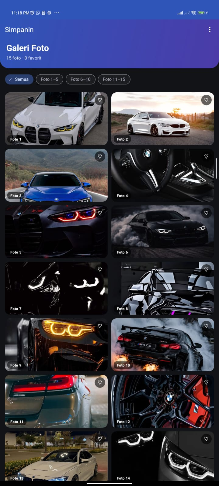
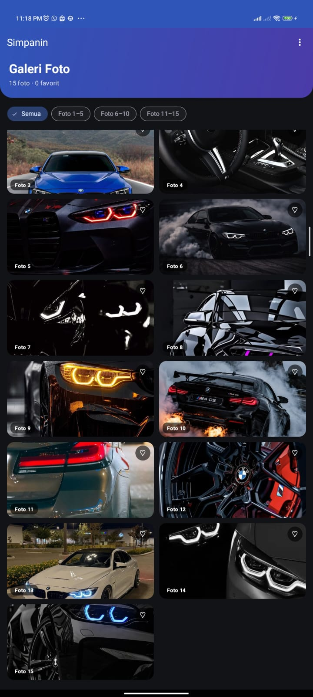
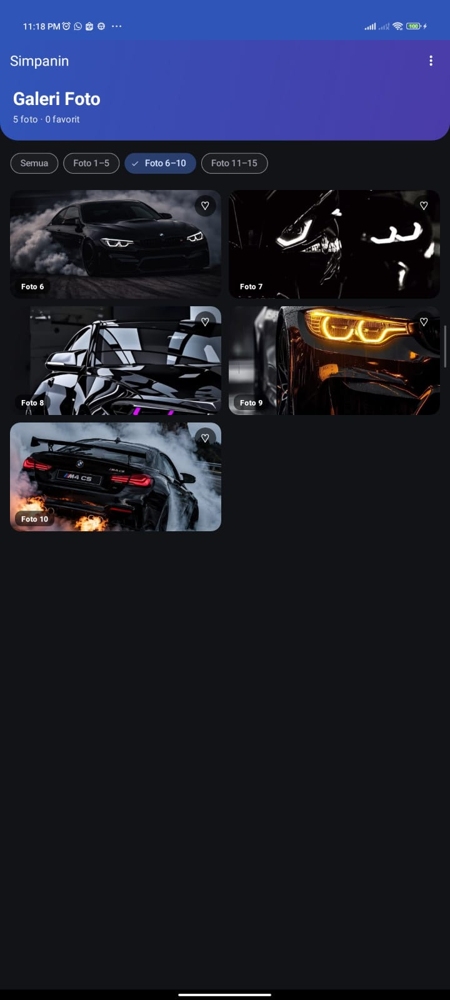
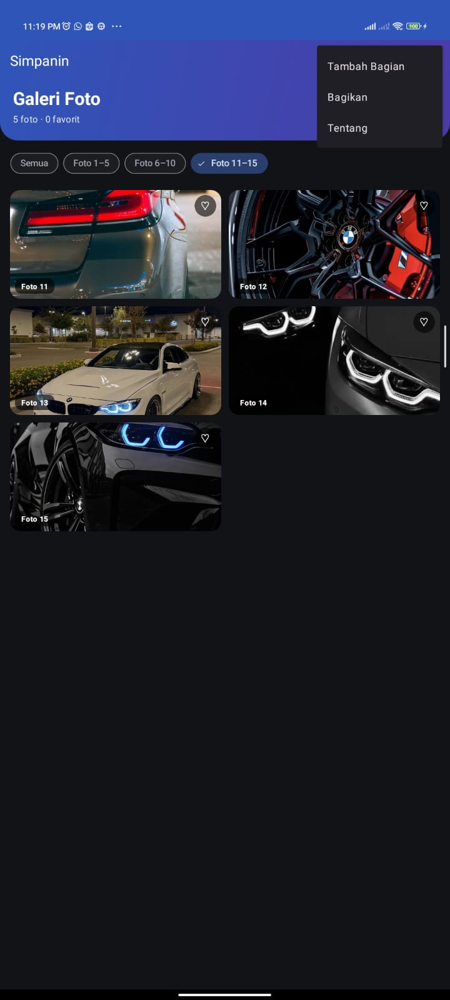
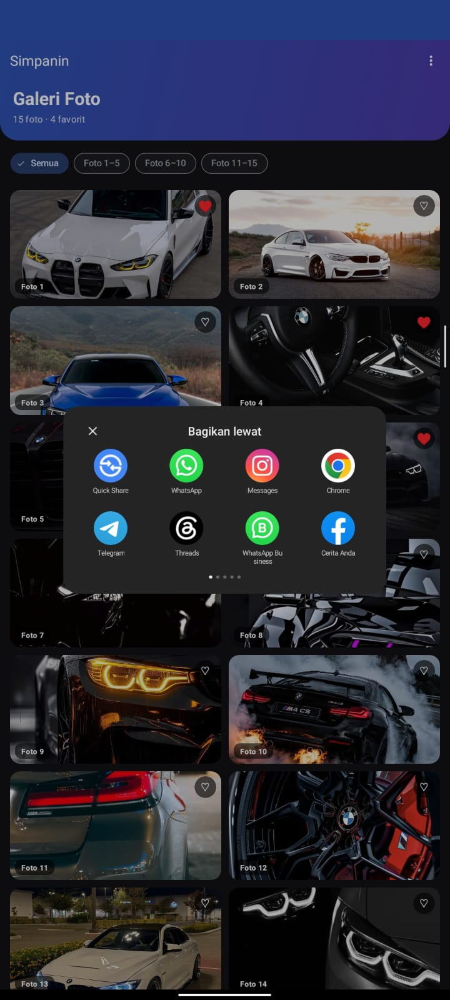
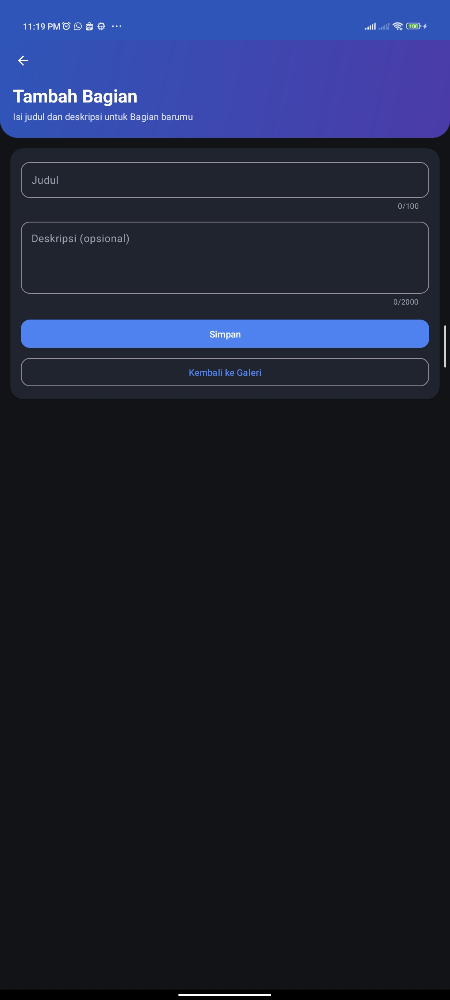

# Simpanin – Modul 4 (Activity Android)

Aplikasi Android (Java, XML View) untuk praktikum **Modul 4**. Aplikasi menampilkan **galeri 15 foto** dalam `GridView`, lengkap dengan filter, tombol favorit, menu opsi berbasis **Intent**, halaman kedua berupa form **Tambah Bagian**, serta **log siklus hidup (lifecycle) Activity**.

Nama dan warna aplikasi mengikuti brief proyek **Simpanin** (aplikasi arsip catatan dan pengingat). Istilah **Bagian** dipakai untuk satu entri catatan.

| Item | Isi |
|---|---|
| Package | `com.example.simpanin_modul_3` |
| Bahasa | Java |
| Template | Empty Views Activity |
| UI | XML + Material Components (Material 3) |
| Tema | Light dan Dark mengikuti sistem |

---

## 1. Tampilan Aplikasi

Seluruh screenshot ada di folder `screanshoot/`.

### Halaman utama

<p>
  
  
</p>

| File | Keterangan |
|---|---|
| `tampilan-01.jpeg` | Tampilan utama: header gradien, filter chip, dan grid foto. |
| `tampilan-02.jpeg` | Tampilan lanjutan galeri (grid foto setelah di-scroll). |

### Fitur

<p>
  
  
</p>

| File | Keterangan |
|---|---|
| `favorite_image.jpeg` | Tombol hati pada foto ditekan dan jumlah favorit di header bertambah. |
| `filter.jpeg` | Filter chip (Semua, Foto 1–5, Foto 6–10, Foto 11–15) menyaring isi grid. |

### Menu (Intent)

<p>
  
  
  
</p>

| File | Keterangan |
|---|---|
| `kebab_menu.jpeg` | Menu titik tiga (overflow) berisi Tambah Bagian, Bagikan, dan Tentang. |
| `menu-bagikan.jpeg` | Menu **Bagikan** membuka pemilih aplikasi lewat **Intent implisit** (`ACTION_SEND`). |
| `menu-tambahkan_bagian.jpeg` | Menu **Tambah Bagian** membuka `SecondActivity` lewat **Intent eksplisit**. |

---

## 2. Fitur

- **Galeri GridView** 2 kolom, menampilkan `pic_1` sampai `pic_15` dari `res/drawable`.
- **Header gradien** dengan sudut bawah membulat dan jumlah foto serta favorit.
- **Filter chip** untuk menyaring rentang foto.
- **Tombol favorit** (♡ / ♥) pada setiap foto.
- **Animasi muncul** pada setiap item grid.
- **Snackbar** saat foto diketuk, dengan aksi menuju halaman Tambah Bagian (membawa foto terpilih).
- **Menu opsi** (`onCreateOptionsMenu` dan `onOptionsItemSelected`) dengan Intent eksplisit dan implisit.
- **Form Tambah Bagian** dengan validasi: judul wajib dan maksimal 100 karakter, deskripsi opsional dan maksimal 2000 karakter.
- **Log siklus hidup** di `MainActivity` (tag `MainActivity`).
- **Dark mode** lewat `values-night`.

---

## 3. Struktur Project

```
app/src/main/
├── AndroidManifest.xml
├── java/com/example/simpanin_modul_3/
│   ├── MainActivity.java
│   ├── SecondActivity.java
│   └── ImageAdapter.java
└── res/
    ├── drawable/            pic_1 ... pic_15
    ├── layout/
    │   ├── activity_main.xml        (LinearLayout)
    │   ├── activity_second.xml      (LinearLayout)
    │   ├── gridview.xml             (GridView)
    │   └── relative_layout.xml      (RelativeLayout, satu sel grid)
    ├── menu/
    │   └── main_menu.xml
    ├── values/
    │   ├── colors.xml
    │   ├── strings.xml
    │   ├── styles.xml
    │   └── themes.xml
    └── values-night/
        ├── colors.xml
        └── themes.xml
```

---

## 4. Alur Aplikasi

```
AndroidManifest.xml
   └─ MainActivity (LAUNCHER)
        ├─ setContentView ──► activity_main.xml
        │                        └─ <include> ──► gridview.xml  (GridView id: gridView)
        ├─ setAdapter ──────► ImageAdapter
        │                        └─ inflate ──► relative_layout.xml (satu sel grid)
        ├─ onCreateOptionsMenu ──► main_menu.xml
        └─ Intent ──► SecondActivity
                         └─ setContentView ──► activity_second.xml
```

---

## 5. Keterangan Setiap File

### 5.1 Java

#### `MainActivity.java`
Activity utama, dibuka pertama kali (LAUNCHER).

| Bagian | Fungsi | Memanggil / memakai |
|---|---|---|
| `onCreate()` | Menyiapkan layout, toolbar, grid, chip, dan klik foto | `activity_main.xml` (`setContentView`), `gridview.xml` lewat id `gridView`, `ImageAdapter` |
| `setSupportActionBar()` | Menjadikan `MaterialToolbar` sebagai action bar | id `toolbar` di `activity_main.xml` |
| `applyHeaderGradient()` | Membuat gradien header lewat `GradientDrawable` | `R.color.simpanin_gradient_start` dan `simpanin_gradient_end` di `colors.xml` |
| `applyInsets()` | Memberi jarak aman untuk status bar dan navigation bar | id `main`, `header`, `gridView` |
| `chipGroup.setOnCheckedStateChangeListener` | Menyaring grid sesuai chip | id `chipAll`, `chip1`, `chip2`, `chip3`, lalu `ImageAdapter.setFilter()` |
| `gridView.setOnItemClickListener` | Menampilkan Snackbar, aksinya membuka `SecondActivity` | `strings.xml` (`snackbar_foto`, `snackbar_action`, `label_foto`) |
| `updateSubtitle()` | Memperbarui teks jumlah foto dan favorit | id `tvSubtitle`, string `subtitle_count` |
| `onCreateOptionsMenu()` | Memuat menu | `R.menu.main_menu` |
| `onOptionsItemSelected()` | Menangani klik menu | id `action_second`, `action_share`, `action_about` |
| `onStart` ... `onDestroy` | Mencetak log siklus hidup | `android.util.Log`, tag `MainActivity` |

Import yang dipakai sesuai tugas: `android.util.Log`, `android.view.Menu`, `android.view.MenuItem`, `android.content.Intent`, `android.widget.Toast`.

#### `ImageAdapter.java`
`BaseAdapter` yang menyediakan isi `GridView`.

| Bagian | Fungsi | Memanggil / memakai |
|---|---|---|
| `IMAGES[]` | Daftar 15 gambar | `R.drawable.pic_1` sampai `pic_15` |
| `getView()` | Membuat atau mendaur ulang satu sel grid | **`relative_layout.xml`** lewat `inflate(R.layout.relative_layout)` |
| ViewHolder | Menyimpan referensi view agar efisien | id `imageItem`, `labelItem`, `btnFav`, `tvHeart` |
| `setFilter(from, to)` | Menampilkan sebagian gambar | dipanggil dari `MainActivity` (chip) |
| `getFavoriteCount()` | Menghitung favorit | dipanggil dari `MainActivity.updateSubtitle()` |
| `updateHeart()` | Mengubah ikon ♡ / ♥ dan warnanya | string `heart_on` / `heart_off`, warna `simpanin_heart` / `white` |
| Animasi di `getView()` | Efek fade dan geser saat item muncul | `View.animate()` |

Dibuat di `MainActivity.onCreate()` dengan `new ImageAdapter(this)` lalu dipasang ke `gridView.setAdapter(adapter)`.

#### `SecondActivity.java`
Halaman **Tambah Bagian**.

| Bagian | Fungsi | Memanggil / memakai |
|---|---|---|
| `onCreate()` | Menyiapkan layout, toolbar, dan data dari Intent | `activity_second.xml` (`setContentView`) |
| `getIntent().getStringExtra(EXTRA_SUMBER)` | Membaca asal pemanggilan | dikirim dari `MainActivity` |
| `getIntent().getIntExtra(EXTRA_GAMBAR, 0)` | Membaca foto terpilih dan menampilkannya di `cardPreview` | dikirim dari Snackbar di `MainActivity` |
| `simpan()` | Validasi form lalu Toast | id `tilJudul`, `etJudul`, `tilDeskripsi`, `etDeskripsi`; string `error_*`, `toast_saved` |
| `onSupportNavigateUp()` | Tombol kembali di toolbar | `finish()` |
| `btnBack` | Kembali ke galeri | `finish()` |

---

### 5.2 Layout XML

#### `activity_main.xml` (LinearLayout)
Dipakai oleh `MainActivity.setContentView(R.layout.activity_main)`.

| Elemen | id | Dipakai di |
|---|---|---|
| Root LinearLayout | `main` | `applyInsets()` dan Snackbar (`MainActivity`) |
| Header | `header` | `applyHeaderGradient()` |
| MaterialToolbar | `toolbar` | `setSupportActionBar()` |
| TextView subtitle | `tvSubtitle` | `updateSubtitle()` |
| ChipGroup | `chipGroup` | listener filter |
| Chip | `chipAll`, `chip1`, `chip2`, `chip3` | pencocokan id di listener filter |
| `<include layout="@layout/gridview">` | – | menyisipkan **`gridview.xml`** |

Memakai: `colors.xml`, `strings.xml`, `styles.xml` (`Widget.Simpanin.Toolbar`, `ThemeOverlay.Simpanin.Toolbar`, `TextAppearance.Simpanin.Display`, `TextAppearance.Simpanin.Subtitle`, `Widget.Simpanin.Chip`).

#### `gridview.xml` (GridView)
Tidak dipanggil lewat Java, tetapi disisipkan ke `activity_main.xml` dengan `<include>`.

| Elemen | id | Dipakai di |
|---|---|---|
| GridView (2 kolom) | `gridView` | `MainActivity`: `findViewById(R.id.gridView)`, `setAdapter()`, `setOnItemClickListener()`, `applyInsets()` |

#### `relative_layout.xml` (RelativeLayout)
Tampilan **satu sel** di dalam grid. Dipanggil di **`ImageAdapter.getView()`**:
`LayoutInflater.from(context).inflate(R.layout.relative_layout, parent, false)`.

| Elemen | id | Dipakai di (`ImageAdapter`) |
|---|---|---|
| ShapeableImageView | `imageItem` | `setImageResource(IMAGES[index])` |
| MaterialCardView (tombol hati) | `btnFav` | `setOnClickListener` (toggle favorit) |
| TextView hati | `tvHeart` | `updateHeart()` |
| TextView badge | `labelItem` | `setText("Foto n")` |

Memakai: `styles.xml` (`ShapeAppearance.Simpanin.Rounded`, `TextAppearance.Simpanin.Badge`), `colors.xml` (`simpanin_scrim`), `strings.xml` (`desc_foto`, `desc_favorit`, `heart_off`).

#### `activity_second.xml` (LinearLayout)
Dipakai oleh `SecondActivity.setContentView(R.layout.activity_second)`.

| Elemen | id | Dipakai di (`SecondActivity`) |
|---|---|---|
| Root | `main` | `applyInsets()` |
| Header | `header` | `applyHeaderGradient()` |
| MaterialToolbar | `toolbar` | `setSupportActionBar()` |
| ScrollView | `scroll` | `applyInsets()` (termasuk jarak keyboard) |
| Kartu lampiran | `cardPreview` | ditampilkan jika ada `EXTRA_GAMBAR` |
| Gambar lampiran | `imgPreview` | `setImageResource()` |
| Teks sumber | `tvMessage` | menampilkan `EXTRA_SUMBER` |
| Input judul / deskripsi | `tilJudul`, `etJudul`, `tilDeskripsi`, `etDeskripsi` | `simpan()` |
| Tombol Simpan | `btnSave` | `simpan()` |
| Tombol Kembali | `btnBack` | `finish()` |

Memakai: `styles.xml` (`Widget.Simpanin.Card`, `Widget.Simpanin.Input`, `Widget.Simpanin.Button`, `Widget.Simpanin.Button.Outlined`, `ShapeAppearance.Simpanin.Rounded`).

---

### 5.3 Menu

#### `menu/main_menu.xml`
Dimuat di `MainActivity.onCreateOptionsMenu()` lewat `getMenuInflater().inflate(R.menu.main_menu, menu)`.

| Item menu | id | Aksi di `onOptionsItemSelected()` | Jenis Intent |
|---|---|---|---|
| Tambah Bagian | `action_second` | Membuka `SecondActivity` dan mengirim `EXTRA_SUMBER` | **Eksplisit** |
| Bagikan | `action_share` | Membuka pemilih aplikasi (`ACTION_SEND`, `text/plain`) | **Implisit** |
| Tentang | `action_about` | Menampilkan `Toast` | – |

---

### 5.4 Resource `values`

#### `values/colors.xml`
Palet warna dari brief (light mode). Dipakai di:
- `styles.xml` dan `themes.xml` (`@color/...`)
- semua layout XML
- `MainActivity` dan `SecondActivity` (`simpanin_gradient_start`, `simpanin_gradient_end`)
- `ImageAdapter` (`simpanin_heart`, `white`)

| Warna | Nilai | Kegunaan |
|---|---|---|
| `simpanin_primary` | `#2F6FED` | Warna utama |
| `simpanin_secondary` | `#12A594` | Warna sekunder |
| `simpanin_background` | `#F7F8FA` | Latar layar |
| `simpanin_surface` | `#FFFFFF` | Latar kartu |
| `simpanin_error` / `warning` / `success` | `#D93025` / `#F59E0B` / `#16A34A` | Status |
| `simpanin_gradient_start` / `end` | `#2F6FED` / `#6A4CE0` | Gradien header |
| `simpanin_chip_selected` | `#DCE7FF` | Chip terpilih |
| `simpanin_scrim` | `#80000000` | Latar badge dan tombol hati |
| `simpanin_heart` | `#FF5C7A` | Hati favorit |

#### `values/strings.xml`
Semua teks tampilan. Dipakai oleh layout (`@string/...`), `main_menu.xml`, file Java (`R.string.*`), dan manifest (`app_name`, `title_second`).

#### `values/styles.xml`
Gaya (style) yang dipanggil dari layout lewat `style=` atau `android:textAppearance=`.

| Style | Dipakai di |
|---|---|
| `TextAppearance.Simpanin.Display` | judul header (`activity_main.xml`, `activity_second.xml`) |
| `TextAppearance.Simpanin.Subtitle` | subtitle header |
| `TextAppearance.Simpanin.Header` | judul kartu (`activity_second.xml`) |
| `TextAppearance.Simpanin.Body` | teks isi (`activity_second.xml`) |
| `TextAppearance.Simpanin.Badge` | label foto (`relative_layout.xml`) |
| `Widget.Simpanin.Toolbar` | toolbar kedua layout |
| `ThemeOverlay.Simpanin.Toolbar` | `android:theme` pada toolbar (ikon putih) |
| `Widget.Simpanin.Button` / `.Outlined` | tombol Simpan / Kembali (`activity_second.xml`) |
| `Widget.Simpanin.Chip` | chip filter (`activity_main.xml`) |
| `Widget.Simpanin.Card` | kartu (`activity_second.xml`) |
| `Widget.Simpanin.Input` | input teks (`activity_second.xml`) |
| `ShapeAppearance.Simpanin.Rounded` | sudut gambar (`relative_layout.xml`, `activity_second.xml`) |
| `ShapeAppearance.Simpanin.Pill` | dipakai oleh `Widget.Simpanin.Chip` |

#### `values/themes.xml`
Tema `Theme.Simpanin_modul_3` (turunan `Theme.Material3.DayNight.NoActionBar`). Dipasang di **`AndroidManifest.xml`** pada atribut `android:theme` di tag `<application>`. Berisi pemetaan warna Material (primary, secondary, surface, background, dan lain-lain).

---

### 5.5 Resource `values-night`

Dipakai otomatis Android saat perangkat dalam **mode gelap**.

| File | Fungsi |
|---|---|
| `values-night/colors.xml` | Menimpa nilai warna dengan **nama yang sama** seperti `values/colors.xml` (latar gelap, teks terang). Tidak perlu mengubah layout atau Java. |
| `values-night/themes.xml` | Tema `Theme.Simpanin_modul_3` versi gelap. Nama sama dengan `values/themes.xml`. |

---

### 5.6 `AndroidManifest.xml`

| Bagian | Fungsi |
|---|---|
| `android:theme="@style/Theme.Simpanin_modul_3"` | Memasang tema dari `themes.xml` |
| `android:label="@string/app_name"` | Nama aplikasi dari `strings.xml` |
| `<activity android:name=".MainActivity">` + intent-filter `MAIN` / `LAUNCHER` | Activity yang dibuka pertama kali |
| `<activity android:name=".SecondActivity">` | Mendaftarkan halaman kedua (`exported="false"`, `parentActivityName=".MainActivity"`, `windowSoftInputMode="adjustResize"`) |

---

## 6. Siklus Hidup Activity (`MainActivity`)

Setiap callback mencetak log `Log.d("MainActivity", "... dipanggil")`. Buka **Logcat**, lalu filter dengan `MainActivity`.

| Callback | Dipanggil saat |
|---|---|
| `onCreate()` | Activity pertama kali dibuat |
| `onStart()` | Activity mulai terlihat |
| `onResume()` | Activity siap berinteraksi |
| `onPause()` | Activity kehilangan fokus (misalnya halaman kedua terbuka) |
| `onStop()` | Activity tidak terlihat lagi |
| `onRestart()` | Activity kembali terlihat setelah `onStop()` |
| `onDestroy()` | Activity dihancurkan |

Cara mencoba:

| Skenario | Urutan log |
|---|---|
| Buka aplikasi | `onCreate` → `onStart` → `onResume` |
| Buka **Tambah Bagian** | `onPause` → `onStop` |
| Kembali dari halaman kedua | `onRestart` → `onStart` → `onResume` |
| Tekan Home | `onPause` → `onStop` |
| Buka lagi dari recent apps | `onRestart` → `onStart` → `onResume` |
| Putar layar | `onPause` → `onStop` → `onDestroy` → `onCreate` → `onStart` → `onResume` |
| Tekan Back sampai keluar | `onPause` → `onStop` → `onDestroy` |

---

## 7. Intent yang Dipakai

| Jenis | Asal | Tujuan | Data |
|---|---|---|---|
| Eksplisit | Menu **Tambah Bagian** (`MainActivity`) | `SecondActivity` | `EXTRA_SUMBER` |
| Eksplisit | Aksi Snackbar saat foto diketuk (`MainActivity`) | `SecondActivity` | `EXTRA_SUMBER` (contoh: "Foto 3") dan `EXTRA_GAMBAR` (id drawable) |
| Implisit | Menu **Bagikan** (`MainActivity`) | Aplikasi lain (chooser) | `ACTION_SEND`, `text/plain`, `EXTRA_TEXT` |

---


## 8. Catatan

- Foto favorit disimpan di memori. Saat Activity dibuat ulang (misalnya layar diputar), status favorit kembali ke awal.
- Tombol **Simpan** pada halaman Tambah Bagian baru melakukan validasi dan menampilkan Toast. Penyimpanan ke Firestore, lampiran, dan pengingat sesuai brief dikerjakan pada tahap berikutnya.
- Teks, warna, dan gaya dipusatkan di folder `values` sehingga mudah diubah tanpa menyentuh layout.

---